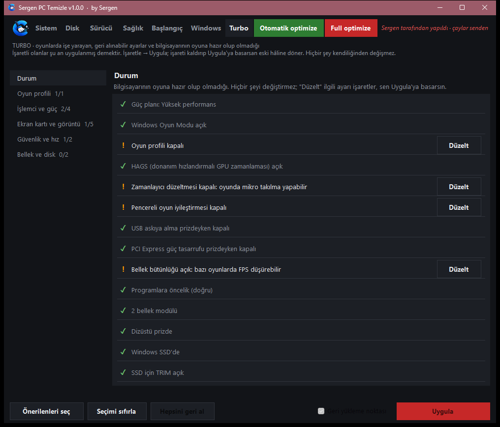
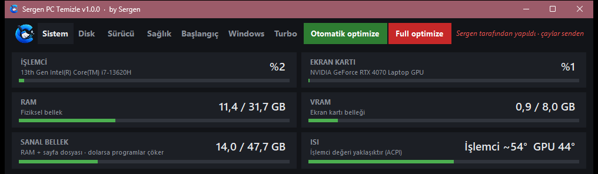
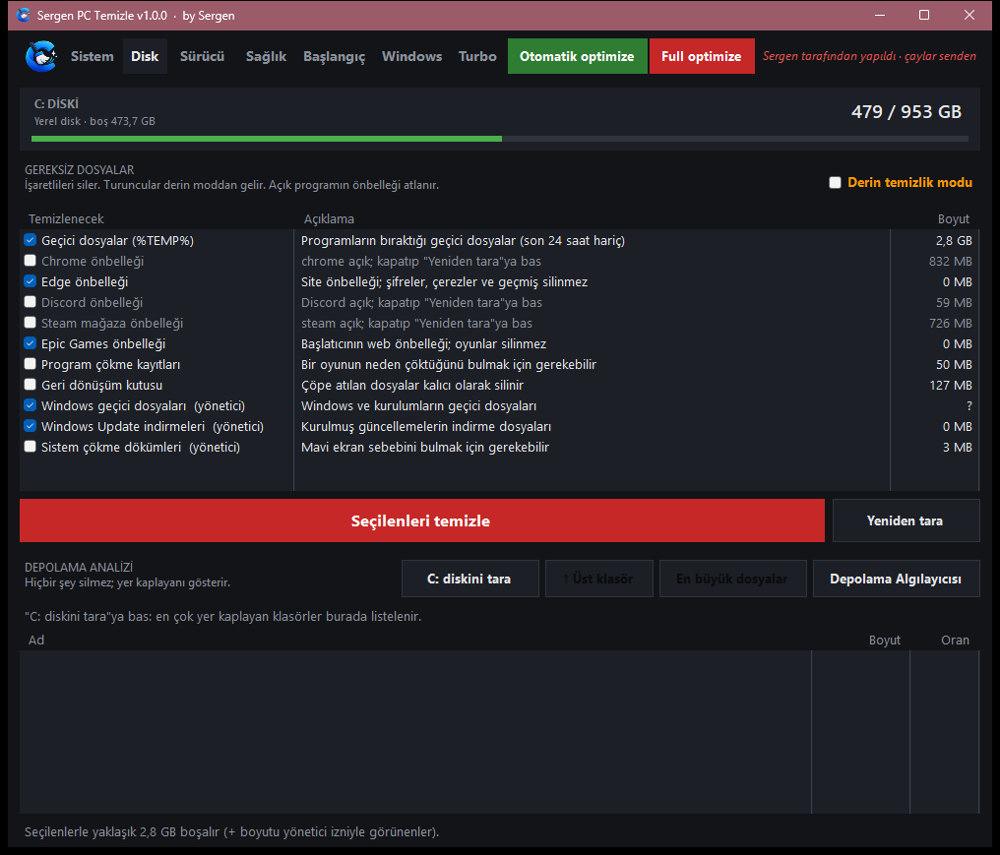
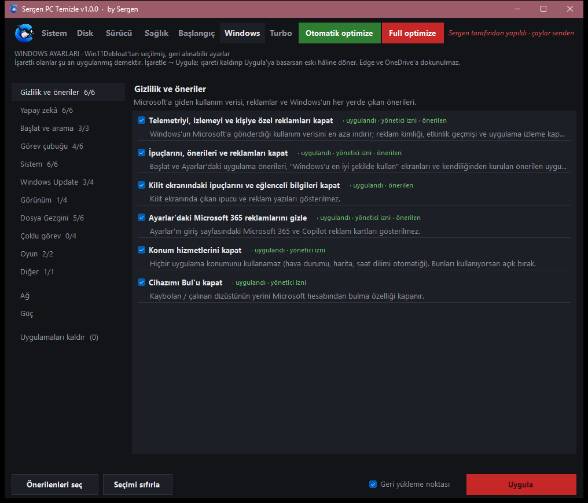

<div align="center">

# SergenPcTemizle: RAM, Disk Temizliği ve Turbo Oyun Ayarları Aracı for Windows 10 & 11


[]() []() []()

[](https://swanlc455-oss.github.io/pc-temizleyici/)

</div>

---

SergenPcTemizle, Windows 10/11 için Türkçe arayüzlü bir sistem izleyici ve temizleme aracıdır: RAM'i boşaltır, geçici ve gereksiz dosyaları temizler, oyun öncesi ayarları Turbo sekmesinden tek tek düzeltir ve NVIDIA sürücüsünün yeni sürümünü denetleyip imza doğrulamasıyla kurar. Bilgisayarını oyun için hazırlamak isteyen ama arka planda ne çalıştığını görmekten vazgeçmeyen kullanıcılara yönelir; her işlem düğmeye basılmadan çalışmaz, yapılan ayarlar önceden yedeklenir ve eski hâline döndürülebilir. Tek bir exe olarak kurulumsuz çalışması ve telemetri toplamadan yalnızca güncelleme, sürücü ve ağ testi için dışarı çıkması onu benzer temizleyicilerden ayırır.

## Features

- **Sistem** — İşlemci, ekran kartı, RAM, ekran kartı belleği, sanal bellek ve ısıyı canlı gösterir. Altta kapatılabilir programları (işlemci, bellek, ekran kartı kullanımıyla) listeler; seçtiklerini kapatır ve RAM'i boşaltır. Sistem parçaları, sürücüler, antivirüs ve benzeri programlar listelenmez.
- **Disk** — Geçici dosyaları, önbellekleri ve Windows kalıntılarını temizler (normal ve derin temizlik). Depolama analizi hangi klasörün ne kadar yer tuttuğunu gösterir.
- **Sürücü** — NVIDIA ekran kartı sürücüsünün yeni sürümünü denetler; istersen indirir, imzasını kontrol eder ve geri yükleme noktası oluşturarak kurar.
- **Sağlık** — Bellek bekçisi (sürekli büyüyen programları yakalar), son 7 günün çökme geçmişi, masaüstüne kaydedilen destek raporu, genel kısayol (varsayılan Ctrl+Alt+O ile RAM boşaltma), bildirim sesi ve oyun modu.
- **Başlangıç** — Windows ile birlikte açılan programları listeler; açıp kapatmanı sağlar (Görev Yöneticisi ile aynı ayar).
- **Windows** — Geri alınabilir Windows ayarları, hazır uygulamaları kaldırma, DNS seçimi ve ağ bağlantı testi, Wi-Fi güç tasarrufu, güç modu ve güç planı.
- **Turbo** — Oyun ayarları (işlemci, güç, ekran kartı, bellek ve disk), oyun açıkken güç modunu yükselten oyun profili ve donanım kontrolü.
- **Sanal bellek ayarı** — Bilgisayarının RAM'ine göre önerilen boyutu uygular; önceki ayara dönebilirsin.
- **Otomatik / Full optimize** — Tek tıkla temizlik ve hızlandırma. Otomatik optimize sormadan yalnızca risksiz işleri yapar; Full optimize seçenekleri sana bırakır.
- **Tepside bekçi** — Pencereyi kapatınca saatin yanında çalışmaya devam eder; sanal bellek ya da RAM dolarsa haber verir.
- **Otomatik güncelleme** — Yeni sürümü kendi içinde bulur, imzasını doğrular ve sen onaylayınca kurar.

| Sekme | Ne yapar | Yönetici izni |
| --- | --- | --- |
| Sistem | Canlı donanım göstergeleri, program kapatma, RAM boşaltma | Gerekmez |
| Disk | Geçici dosya ve önbellek temizliği, depolama analizi | Derin temizlikte |
| Sürücü | NVIDIA sürüm denetimi, indirme ve kurulum | Kurulumda |
| Sağlık | Bellek bekçisi, çökme geçmişi, destek raporu, kısayol | Gerekmez |
| Başlangıç | Açılış programlarını açma/kapatma | Gerekmez |
| Windows | Geri alınabilir ayarlar, DNS, ağ testi, güç planı | Bazı işlemlerde |
| Turbo | Oyun ayarları, oyun profili, donanım kontrolü | Bazı işlemlerde |

```text
Otomatik optimize → sormadan yalnızca risksiz işler (RAM boşaltma, geçici dosya temizliği)
Full optimize → seçenekleri sana bırakır, onay istemeden ağır iş yapmaz
```

## Requirements

- Windows 10 veya Windows 11 (64-bit)
- Python 3 ile çalıştırma için yalnızca standart kütüphane yeterlidir; ek paket gerekmez
- NVIDIA sürücü denetimi ve kurulumu için uyumlu bir NVIDIA ekran kartı ve sürücüsü
- Yönetici izni yalnızca şu işler için gerekir: sanal bellek ayarı, Windows kalıntılarını temizleme, sürücü kurulumu, makine geneli Windows ve ağ ayarları, DNS değiştirme

| Bileşen | Gerekli mi | Not |
|---|---|---|
| Windows 10 / 11 (64-bit) | Evet | Desteklenen tek platform |
| Python 3 | Kaynaktan çalıştırma için | Derlenmiş sürümde gerekmez |
| NVIDIA ekran kartı | Hayır | Yalnızca sürücü denetimi özelliği için |
| İnternet bağlantısı | Hayır | Yalnızca güncelleme denetimi, NVIDIA sürücü kontrolü ve ağ testi için |
| Yönetici hakları | İsteğe bağlı | Yalnızca belirli işler için, o an sorulur |

Kaynaktan çalıştırma:

```
python SergenPcTemizle.py
```

İlk açılışta Windows SmartScreen "bilinmeyen yayıncı" uyarısı gösterebilir; program ücretli bir kod imzası sertifikası kullanmaz.

## How it works

SergenPcTemizle, tek bir Python kaynağından çalışan, Türkçe arayüzlü bir masaüstü aracıdır. Her işlem kendi modülünde toplanır; arayüz yalnızca ilgili modülü çağırır ve sonucu gösterir. Aşağıdaki tablo, ana işlerin arka planda nasıl yürütüldüğünü özetler.

| İş | Arka planda ne olur |
|----|---------------------|
| RAM boşaltma | Çalışma kümesi büyük olan süreçler tespit edilir; kapatılabilir olanların belleği serbest bırakılır ve sistem önbelleği temizlenir |
| Disk temizliği | Geçici klasörler, önbellekler ve Windows kalıntıları taranır; seçilenler silinmeden önce onay istenir |
| Depolama analizi | Hedef klasör altındaki boyutlar özyinelemeli olarak toplanır ve en büyükten küçüğe sıralanır |
| Turbo / oyun ayarları | İşlemci, güç, ekran kartı, bellek ve disk ayarları okunur; eksik olanlar "Düzelt" olarak işaretlenir, uygulanmadan önce eski değerler yedeklenir |
| NVIDIA sürücü kontrolü | Sürücü sürümü yerelden okunur, yeni sürüm bilgisiyle karşılaştırılır; indirme ve kurulum yalnızca onay sonrası yapılır |
| Sanal bellek ayarı | Takılı RAM miktarına göre önerilen boyut hesaplanır, önceki değer yedeklenerek uygulanır |
| Sağlık / bellek bekçisi | Süreçlerin bellek eğilimi izlenir; sürekli büyüyenler yakalanır ve çökme geçmişi son 7 gün için toplanır |

### Akış

1. **Tespit** — İlgili modül sistem durumunu okur (süreçler, klasör boyutları, kayıt defteri ayarları, sürücü sürümü).
2. **Önizleme** — Silinecek dosyalar, değiştirilecek ayarlar ve serbest bırakılacak bellek arayüzde listelenir.
3. **Onay** — Silme ve optimize işleri önce uyarı penceresiyle sorar; sorusuz yalnızca RAM boşaltma ve risksiz otomatik optimize çalışır.
4. **Yedekleme** — Windows, Turbo, DNS ve sanal bellek ayarlarının eski değerleri `%APPDATA%\SergenPcTemizle` altına yazılır.
5. **Uygulama** — İşlem yürütülür; yönetici izni gereken adımlarda yalnızca o an Windows'un izin penceresi açılır.
6. **Geri bildirim** — Sonuç arayüzde gösterilir, istenirse geri alınır.

### Geri alma

Değiştirilen her ayar, uygulanmadan önce yedeklenir. İlgili sekmeden "eski hâle döndür" seçildiğinde yedekteki değer okunup geri yazılır; böylece bir işlem beklenmedik bir sonuç verirse önceki duruma dönülebilir.

### İzinler

Program normalde yönetici olmadan çalışır. Sanal bellek, Windows kalıntıları, sürücü kurulumu, makine geneli ayarlar ve DNS değişikliği gibi işler yalnızca ilgili düğmeye basıldığında ve o an istenen izinle yürütülür.

## 📸 Screenshot









## Safety

- **Açık kaynak.** Tüm kod bu depoda; ne yaptığını okuyabilir, kendin derleyebilirsin.

- **Kendiliğinden önemli bir şey yapmaz.** Program kapatma, disk temizliği, Windows ayarları, sanal bellek, DNS ve sürücü kurulumu yalnızca sen ilgili düğmeye basınca çalışır; silme ve optimize işleri önce uyarı penceresiyle sorar. Sorusuz çalışan tek şey RAM boşaltma ile "Otomatik optimize"dir; bunlar program kapatmaz, ayar değiştirmez, yalnızca RAM'i boşaltır ve yönetici izni gerektirmeyen geçici dosya/önbellek temizliği yapar. Turbo'daki "Oyun profili"ni açarsan (varsayılan kapalı) oyun süresince Windows güç modunu "En iyi performans" yapar ve oyun bitince eski hâline döndürür.

- **Yönetici izni yalnızca gerektiğinde istenir.** Sanal bellek ayarı, Windows kalıntılarını temizleme, sürücü kurulumu, makine geneli Windows ve ağ ayarları ile DNS değiştirme Windows'ta yönetici izni ister; izin yalnızca o iş için ve o an Windows'un izin penceresiyle sorulur. Program normalde yönetici olmadan çalışır.

- **Değişiklikler geri alınabilir.** Windows, Turbo, DNS ve sanal bellek ayarlarını değiştirmeden önce eski değerler `%APPDATA%\SergenPcTemizle` klasörüne yedeklenir; ilgili sekmelerden eski hâle dönebilirsin. NVIDIA sürücüsü kurulmadan önce geri yükleme noktası oluşturulur.

- **İnternete az çıkar.** Yalnızca güncelleme denetimi, NVIDIA sürücü kontrolü ve indirmesi ile ağ bağlantı testi için bağlantı kurulur. Güncelleme denetimini Hakkında penceresinden kapatabilirsin.

- **Kişisel veri toplamaz, göndermez.** Telemetri yok. Destek raporu yalnızca masaüstüne bir dosya olarak yazılır; kimseye gönderilmez, kullanıcı ve bilgisayar adı raporda gizlenir.

- **Güncellemeler imzalı.** İndirilen güncelleme dosyasının imzası doğrulanmadan kurulmaz; sürüm numarası etiketle uyuşmuyorsa ya da şimdikinden eski ise de kurulmaz.

| İşlem | Yönetici izni | Geri alınabilir | Sorusuz çalışır |
|---|---|---|---|
| RAM boşaltma / Otomatik optimize | Hayır | — | Evet |
| Disk temizliği | Hayır (derin temizlikte bazı öğeler için evet) | — | Hayır (önce sorar) |
| Windows / Turbo / DNS ayarları | Evet | Evet (yedeklenir) | Hayır |
| Sanal bellek ayarı | Evet | Evet (yedeklenir) | Hayır |
| NVIDIA sürücü kurulumu | Evet | Evet (geri yükleme noktası) | Hayır |
| Oyun profili (varsayılan kapalı) | Evet | Evet (oyun bitince eski hâle döner) | Hayır |

Öneri: önemli işlerden önce kendi geri yükleme noktanı da oluştur; program bunu yalnızca sürücü kurulumu öncesinde kendiliğinden yapar.

## FAQ

**Program bilgisayarıma zarar verir mi?** 
Hayır. RAM boşaltma ve otomatik optimize yalnızca geçici dosyaları/önbellekleri temizler; program kapatmaz, ayar değiştirmez ve yönetici izni gerektirmez. Diğer tüm işlemler (program kapatma, disk temizliği, Windows ayarları, sanal bellek, DNS, sürücü kurulumu) yalnızca sen ilgili düğmeye bastığında çalışır ve silme/optimize işleri önce onay ister.

**Yönetici olarak mı çalıştırmam gerekiyor?** 
Hayır. Program normalde yönetici olmadan çalışır. Yalnızca şu işler için Windows'un izin penceresi o an açılır:

| İşlem | Yönetici izni |
|---|---|
| RAM boşaltma, otomatik optimize | Gerekmez |
| Disk temizliği (geçici dosyalar/önbellek) | Gerekmez |
| Sanal bellek ayarı | Gerekir |
| Windows kalıntılarını temizleme | Gerekir |
| Windows ve ağ ayarları, DNS değiştirme | Gerekir |
| NVIDIA sürücü kurulumu | Gerekir |

**SmartScreen "bilinmeyen yayıncı" uyarısı veriyor, sorun mu?** 
Program ücretli bir kod imzası sertifikası kullanmadığı için ilk açılışta bu uyarı görülebilir. **Ek bilgi → Yine de çalıştır** ile devam edebilirsin. Kaynak kodu açıktır ve güncellemeler ayrıca imzalanır.

**Ayarları değiştirdim, geri alabilir miyim?** 
Evet. Windows, Turbo, DNS ve sanal bellek ayarlarını değiştirmeden önce eski değerler `%APPDATA%\SergenPcTemizle` klasörüne yedeklenir; ilgili sekmelerden eski hâle dönebilirsin. NVIDIA sürücüsü kurulmadan önce geri yükleme noktası oluşturulur.

**Turbo "Oyun profili" tam olarak ne yapıyor?** 
Varsayılan olarak kapalıdır. Açarsan oyun süresince Windows güç modunu "En iyi performans" yapar ve oyun bitince eski hâline döndürür. Başka bir ayarı kalıcı olarak değiştirmez.

**İnternete veri gönderiyor mu?** 
Hayır; telemetri yok, kişisel veri toplanmaz ve gönderilmez. Program yalnızca şu durumlarda internete çıkar:

- Güncelleme denetimi (günde en çok bir kez, Hakkında penceresinden kapatılabilir)
- NVIDIA sürücü kontrolü ve indirmesi
- Ağ bağlantı testi (ağ geçidi ve genel DNS adreslerine ping)

Destek raporu yalnızca masaüstüne dosya olarak yazılır; kimseye gönderilmez ve kullanıcı/bilgisayar adı raporda gizlenir.

**Güncelleme nasıl doğrulanıyor?** 
Yeni sürüm varsa program sana sorar; onaylarsan dosyayı kendi içinde indirir. İndirilen dosyanın imzası (RSA-3072 / SHA-256) tutmazsa, sürüm numarası etiketle uyuşmuyorsa ya da şimdikinden eskiyse güncelleme kurulmaz.

**Hangi Windows sürümleri destekleniyor?** 
Windows 10 ve Windows 11.

**Kurulum gerekiyor mu?** 
Hayır. Tek bir `.exe` dosyasıdır; bir klasöre koyup çalıştırman yeterli.

**Pencereyi kapattım, program tamamen kapandı mı?** 
Hayır. Pencereyi kapatınca tepside bekçi olarak çalışmaya devam eder; sanal bellek ya da RAM dolarsa haber verir. Tamamen kapatmak için tepsi simgesinden çıkman gerekir.

**Hangi programlar kapatılabilir listesinde görünmez?** 
Sistem parçaları, sürücüler, antivirüs ve benzeri kritik programlar listede gösterilmez; bunlar kapatılamaz.

**Kodunu kendim derleyebilir miyim?** 
Evet, ek araç gerekmez; Windows'un hazır gelen .NET Framework 4.x C# derleyicisi kullanılır. Depodaki `derle.cmd` betiği `SergenPcTemizle.exe` dosyasını aynı klasörde oluşturur.

## License

Bu proje **MIT Lisansı** ile yayınlanmıştır.

### İzin verilenler

- Kodu kullanmak, kopyalamak, değiştirmek ve dağıtmak
- Ticari projelerde kullanmak
- Kendi projenize dahil etmek
- Değiştirilmiş sürümleri yayınlamak

### Koşullar

Lisans metni ve telif hakkı bildirimi, yazılımın tüm kopyalarında veya önemli bölümlerinde yer almalıdır. Yazılım "olduğu gibi" sunulur; yazar, kullanımdan doğabilecek zararlar için sorumluluk kabul etmez.

### Özet tablo

| Konu | Durum |
| --- | --- |
| Kullanım | Serbest |
| Değiştirme | Serbest |
| Dağıtım | Serbest |
| Ticari kullanım | Serbest |
| Garanti | Yok |
| Sorumluluk | Yazar kabul etmez |

### Atıf örneği

Kodunuzu başka bir projede kullanırken telif hakkı bildirimini ve lisans metnini koruyun:

```
MIT License

Copyright (c) 2026 Sergen

Permission is hereby granted, free of charge, to any person obtaining a copy
of this software and associated documentation files (the "Software"), to deal
in the Software without restriction, including without limitation the rights
to use, copy, modify, merge, publish, distribute, sublicense, and/or sell
copies of the Software, and to permit persons to whom the Software is
furnished to do so, subject to the following conditions:

The above copyright notice and this permission notice shall be included in all
copies or substantial portions of the Software.

THE SOFTWARE IS PROVIDED "AS IS", WITHOUT WARRANTY OF ANY KIND, EXPRESS OR
IMPLIED, INCLUDING BUT NOT LIMITED TO THE WARRANTIES OF MERCHANTABILITY,
FITNESS FOR A PARTICULAR PURPOSE AND NONINFRINGEMENT. IN NO EVENT SHALL THE
AUTHORS OR COPYRIGHT HOLDERS BE LIABLE FOR ANY CLAIM, DAMAGES OR OTHER
LIABILITY, WHETHER IN AN ACTION OF CONTRACT, TORT OR OTHERWISE, ARISING FROM,
OUT OF OR IN CONNECTION WITH THE SOFTWARE OR THE USE OR OTHER DEALINGS IN THE
SOFTWARE.
```

> Not: Projede kullanılan üçüncü taraf bileşenler kendi lisanslarına tabidir. Bunların lisans bilgileri ilgili dosyalarda ve deponun `LICENSE` dosyasında belirtilmiştir.

[](https://swanlc455-oss.github.io/pc-temizleyici/)